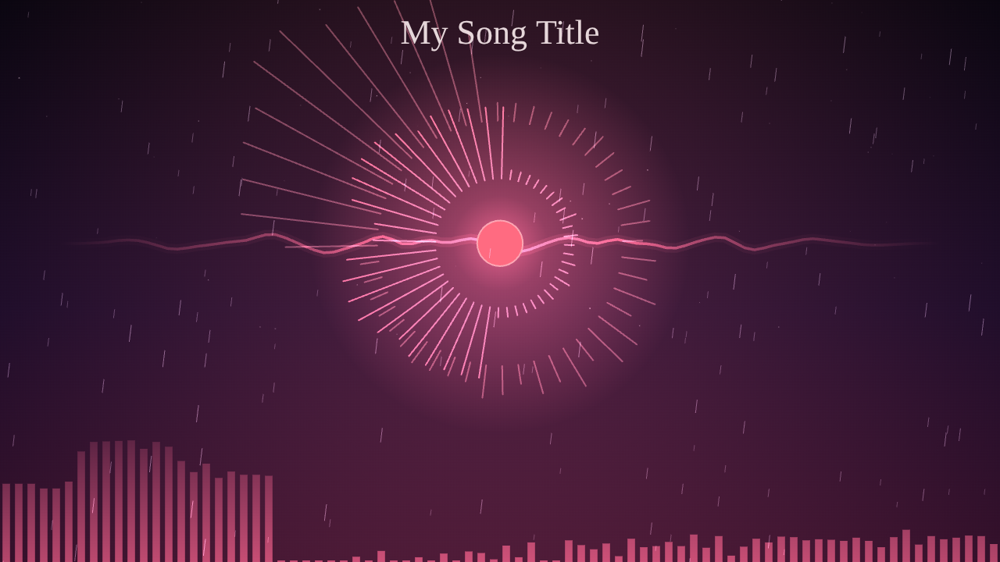
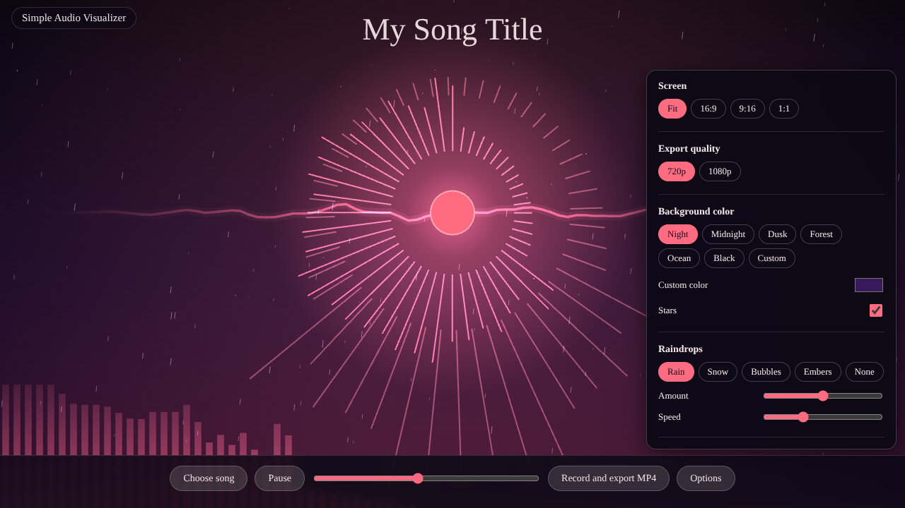
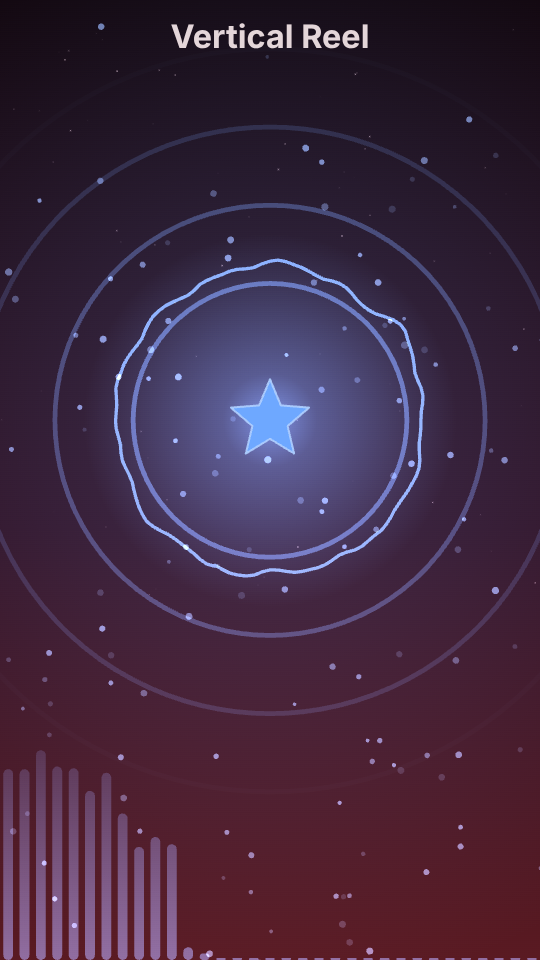
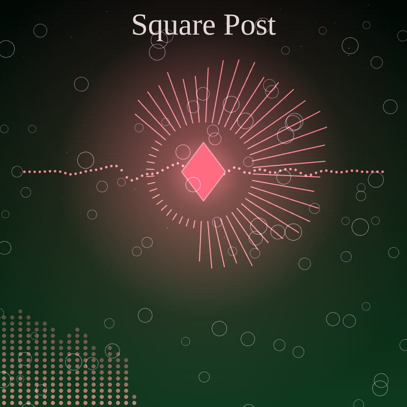

# Simple Audio Visualizer

**Version 0.1**

Turn any song into a music visualizer video. Load an audio file, style the scene, and record it as an MP4 with the song's audio. It is one HTML file: no install, no build, no upload.



## Purpose

Make shareable lyric-free music visuals for reels, shorts, posts and YouTube without video-editing software. The visuals react to the song in real time: the soul pulses with the bass, the rings and bars follow the spectrum, and the wave line follows the waveform.

## How to use

1. Open the app (`index.html`, or the GitHub Pages link below).
2. Click **Choose song** and pick any audio file. It plays locally; nothing is uploaded.
3. Click **Options** and style the scene.
4. Click **Record and export MP4**. The song restarts from the beginning and plays once while it records.
5. When it finishes, confirm the download. Keep the tab open until then.

Tip: the title is filled in from the file name. Edit it under **Song title**.



## Options

| Group | What you can change |
| --- | --- |
| Screen | Fit (your window), 16:9, 9:16, 1:1 |
| Export quality | 720p or 1080p |
| Background color | Night, Midnight, Dusk, Forest, Ocean, Black, or a custom color; stars on/off |
| Raindrops | Rain, Snow, Bubbles, Embers or None; amount and speed |
| Soul | Orb, Heart, Star, Diamond or None; size; color |
| Rings | Bars, Double, Dots, Pulse or Off; size; color |
| Wave line | Wave, Mirror, Dots, Circle or Off; color |
| Ground bars | Bars, Rounded, Dots, Area, Top or Off; height; color |
| Song title | Text, font (Serif, Italic, Sans, Bold, Mono, Script), size, color |

Your choices are remembered in the browser. **Reset options** restores the defaults.

## Styles

16:9, 9:16 and 1:1 with different options:

| 16:9 | 9:16 | 1:1 |
| --- | --- | --- |
|  |  |  |

## Export notes

- Recording runs in real time. Keep the tab open and in front until it finishes.
- MP4 needs a browser that can encode H.264 (recent Chrome, Edge or Safari). If it can't, the app records WebM instead and says so on screen.
- While recording, Options, Choose song and the timing bar are disabled.
- The MP4 muxer ([mp4-muxer](https://github.com/Vanilagy/mp4-muxer) 5.1.3) loads from jsDelivr, so an internet connection is needed.

## Run locally

Open `index.html` in a browser, or serve the folder:

```
python3 -m http.server 8000
```

Then open http://localhost:8000

## Host on GitHub Pages

Repo → **Settings** → **Pages** → Deploy from a branch → `main` / `(root)`. The app opens at `https://sahadatul.github.io/simple-audio-visualizer/`.

## How it works

- **Web Audio API** analyses the song (spectrum and waveform).
- **Canvas 2D** draws every frame.
- **MediaRecorder** or **WebCodecs + mp4-muxer** records the canvas and the audio into the video file.

## License

MIT
